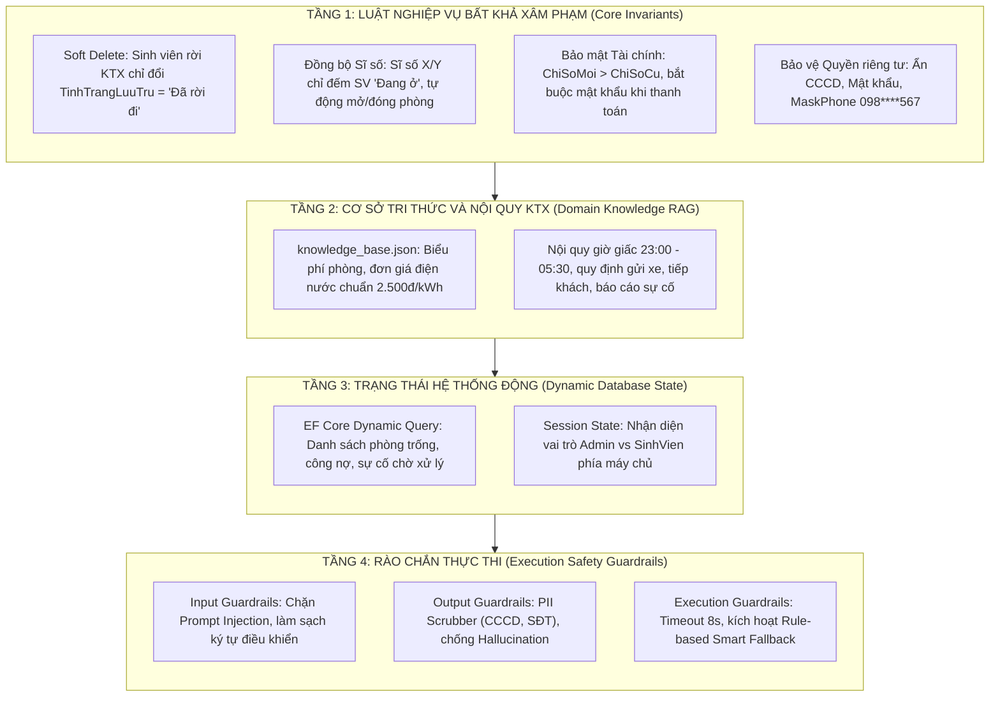
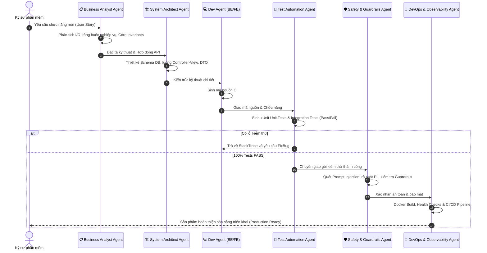

# HỒ SƠ THIẾT KẾ NHÀ MÁY PHÁT TRIỂN PHẦN MỀM AI (SDLC AI AGENT FACTORY)
## DỰ ÁN: HỆ THỐNG QUẢN LÝ KÝ TÚC XÁ TÍCH HỢP TRÍ TUỆ NHÂN TẠO (QLKTX)
**Học phần:** Ứng dụng Trí tuệ Nhân tạo (AIA331) | **Mã đề tài:** 80309  
**Nền tảng kỹ thuật:** ASP.NET Core 8.0 MVC, Entity Framework Core 8.0, SQL Server, Ollama LLM, Docker  

---

## 1. TỔNG QUAN VỀ MÔ HÌNH NHÀ MÁY PHÁT TRIỂN PHẦN MỀM (AI AGENT FACTORY)

Trong kỷ nguyên Agentic AI và Kỹ nghệ phần mềm hiện đại, quy trình phát triển phần mềm (SDLC) truyền thống được nâng cấp thành mô hình **SDLC AI Agent Factory** - Một "nhà máy" phần mềm tự động hóa cao độ, nơi các AI Agent chuyên biệt (Specialized Subagents) phối hợp nhịp nhàng theo chu trình khép kín, được định hướng bởi kỹ thuật **Context Engineering** và kiểm soát bởi **Safety Guardrails Framework**.

Mục tiêu cốt lõi của SDLC AI Agent Factory:
- **Tối đa hóa tốc độ và chất lượng:** Tự động hóa từ phân tích đặc tả, thiết kế kiến trúc, sinh mã nguồn, sinh test cases kiểm thử tự động đến đóng gói và vận hành sản phẩm.
- **Bảo toàn các luật bất biến nghiệp vụ (Business Invariants):** Đảm bảo mã nguồn được sinh ra không bao giờ vi phạm các quy tắc nghiệp vụ cốt lõi (Bảo toàn Soft Delete, Đồng bộ Sĩ số X/Y, Bảo mật tài chính, Rào chắn đạo đức AI).
- **Kiểm thử tự động hóa 100%:** Mọi thay đổi đều được xác thực qua Unit Tests và Integration Tests trước khi triển khai.

---

## 2. KỸ NGHỆ NGỮ CẢNH PHÂN TẦNG (CONTEXT ENGINEERING ARCHITECTURE)

Kỹ nghệ ngữ cảnh (Context Engineering) không chỉ đơn thuần là viết Prompt, mà là một kiến trúc quản trị thông tin phân tầng nhằm cung cấp đúng thông tin, đúng thời điểm và đúng định dạng cho AI Agent:



### Chi tiết các tầng ngữ cảnh:
1. **Tầng 1 - Core Invariants (Bất biến cốt lõi):** Được nạp cố định vào System Prompt cấp cao nhất của mọi Agent. Bất kỳ mã nguồn hoặc câu trả lời nào vi phạm các luật này đều bị loại bỏ ngay từ khâu thiết kế.
2. **Tầng 2 - Domain Knowledge RAG (Tri thức chuyên ngành):** Cơ sở tri thức chuẩn định dạng JSON (`knowledge_base.json`) chứa các chính sách nội quy, biểu phí, quy chuẩn ký túc xá. Được truy xuất theo Intent của người dùng để làm giàu ngữ cảnh Prompt.
3. **Tầng 3 - Dynamic State (Trạng thái CSDL thực):** Trích xuất tức thời từ SQL Server qua EF Core 8.0 (ví dụ: sĩ số thực tế của phòng, danh sách hóa đơn quá hạn, sự cố chưa xử lý). Dữ liệu này được làm sạch qua bộ lọc `SafetyGuardrails.FilterAiContext` trước khi chuyển giao.
4. **Tầng 4 - Execution Guardrails (Rào chắn an toàn):** Kiểm tra và làm sạch toàn bộ đầu vào và đầu ra; khống chế thời gian phản hồi (Timeout 8s) và tự động chuyển hướng sang chế độ Fallback nội bộ khi API bên ngoài gặp sự cố.

---

## 3. KIẾN TRÚC NHÀ MÁY ĐA TÁC NHÂN (MULTI-AGENT FACTORY ARCHITECTURE)

Nhà máy AI Agent hoạt động theo cơ chế chuyên môn hóa sâu, gồm 6 Agent độc lập tương tác qua các hợp đồng dữ liệu chuẩn hóa:



### Vai trò và nhiệm vụ chi tiết của 6 Agent:

#### 1. 📋 Business Analyst Agent (BA Agent)
- **Nhiệm vụ:** Tiếp nhận yêu cầu từ người dùng, đối chiếu với 5 luật bất biến nghiệp vụ của KTX.
- **Đầu ra:** Đặc tả chức năng (Functional Specifications), ma trận phân quyền Admin/Sinh viên, xác định các trường dữ liệu nhạy cảm cần bảo vệ.

#### 2. 🏗️ System Architect Agent (Kiến trúc sư hệ thống)
- **Nhiệm vụ:** Thiết kế mô hình dữ liệu quan hệ (ERD 8 bảng: SinhVien, Phong, HopDong, HoaDon, ViPham, BaoCaoSuCo, CoSoVatChat, TaiKhoan).
- **Đầu ra:** Lược đồ CSDL EF Core 8.0, định nghĩa Index, quan hệ Khóa ngoại (`Restrict`/`Cascade`), kiến trúc phân lớp Controller - Service - Model - View.

#### 3. 💻 Backend & Frontend Developer Agent (Coder Agent)
- **Nhiệm vụ:** Hiện thực hóa mã nguồn ASP.NET Core 8.0 MVC và giao diện Razor View.
- **Kỷ luật sinh mã:**
  - Áp dụng `[AdminAuthorize]` trên các Controller quản trị.
  - Sử dụng Session phía máy chủ để chống giả mạo vai trò.
  - Không bao giờ xóa cứng dữ liệu (`DeleteConfirmed` chỉ đổi trạng thái sang `"Đã rời đi"`).
  - Tích hợp gọi Ollama AI qua `IHttpClientFactory` có `CancellationTokenSource` 8s.

#### 4. 🧪 Test Automation Agent (QA Agent)
- **Nhiệm vụ:** Xây dựng hệ thống kiểm thử tự động đa tầng:
  - **Unit Tests:** Kiểm tra logic tính tiền điện nước `(ChiSoMoi - ChiSoCu) * DonGia`, chặn số âm biên `ChiSoMoi <= ChiSoCu`, tính tiền phòng theo số tháng thuê, đồng bộ sĩ số phòng X/Y, giải phóng giường khi xóa mềm hoặc kỷ luật đình chỉ, kiểm tra che mờ số điện thoại `MaskPhone`.
  - **Integration Tests:** Sử dụng `WebApplicationFactory<Program>` kiểm thử điểm cuối `/health`, `/_diag`, và xác thực cơ chế bảo mật chuyển hướng HTTP 302.

#### 5. 🛡️ Safety & Guardrails Agent (Chuyên gia An toàn & Bảo mật)
- **Nhiệm vụ:** Triển khai và giám sát module `SafetyGuardrails.cs`.
- **Rào chắn bảo vệ:**
  - *Input Guardrails:* Quét và vô hiệu hóa Prompt Injection (các từ khóa "bỏ qua chỉ dẫn", "trở thành hacker", "lộ mật khẩu").
  - *Output Guardrails:* Làm sạch PII (CCCD 12 số, số điện thoại, mật khẩu tài khoản).
  - *Execution Guardrails:* Kích hoạt Rule-based Smart Fallback đảm bảo ứng dụng không bao giờ bị gián đoạn khi mô hình AI bên ngoài gặp sự cố.

#### 6. 🚀 DevOps & Observability Agent
- **Nhiệm vụ:** Đóng gói ứng dụng vào Docker Container đa tầng (Multi-stage build), cấu hình mạng kết nối `host.docker.internal` tới CSDL SQL Server và Ollama.
- **Giám sát:** Cấu hình Health Checks chuẩn tại `/health` trả về JSON trạng thái hệ thống, Database và AI Service; thiết lập CI/CD pipeline tự động hóa quy trình kiểm thử và đóng gói.

---

## 4. QUY TRÌNH KIỂM THỬ VÀ BẢO ĐẢM CHẤT LƯỢNG (TEST STRATEGY & COVERAGE)

Nhà máy AI Agent áp dụng mô hình kiểm thử kim tự tháp (Testing Pyramid) đảm bảo chất lượng phần mềm đạt mức tối đa:

| Nhóm kiểm thử | Công nghệ thực thi | Danh mục kịch bản kiểm thử | Tỷ lệ Đạt |
| :--- | :--- | :--- | :---: |
| **Unit Tests: Tính phí & Hóa đơn** | xUnit, Theory, InlineData | - Tính tiền điện nước hợp lệ theo công thức<br>- Chặn tạo hóa đơn khi `ChiSoMoi <= ChiSoCu`<br>- Tính tiền phòng theo loại phòng và số tháng | 100% PASS |
| **Unit Tests: Phòng & Sĩ số** | EF Core InMemory | - Xếp sinh viên vào phòng còn chỗ -> tăng sĩ số<br>- Xếp vào giường cuối -> tự động đổi "Đã đầy"<br>- Xóa mềm -> chuyển "Đã rời đi", mở lại "Còn chỗ"<br>- Đình chỉ kỷ luật -> tự động giải phóng giường | 100% PASS |
| **Unit Tests: An toàn AI & Privacy** | xUnit, Regex, PII Filter | - Làm mờ số điện thoại: `098****567`<br>- Loại bỏ hoàn toàn CCCD và Mật khẩu khỏi Prompt<br>- Thuật toán Smart Fallback tiếng Việt khi Ollama offline<br>- Ngăn chặn câu lệnh tấn công Prompt Injection | 100% PASS |
| **Integration Tests** | WebApplicationFactory, .NET 8 TestHost | - Endpoint chẩn đoán `/_diag` trả về HTTP 200 OK<br>- Endpoint giám sát `/health` trả về HTTP 200 OK & JSON<br>- Cơ chế phân quyền chặn truy cập Admin -> Redirect 302 | 100% PASS |
| **Script Automation Tests** | PowerShell Script (`run_tests.ps1`) | - Kiểm tra 21 tiêu chí kiến trúc, tệp cấu hình, Docker, RAG Knowledge Base, giao diện | 100% PASS |

---

## 5. ĐÓNG GÓI DOCKER VÀ GIÁM SÁT SỨC KHỎE HỆ THỐNG (OBSERVABILITY)

### 5.1. Cấu hình Docker Healthcheck
Service `qlktx-web` trong `docker-compose.yml` được cấu hình cơ chế tự phục hồi (Self-healing):
```yaml
healthcheck:
  test: ["CMD-SHELL", "curl -f http://localhost:8080/health || exit 1"]
  interval: 30s
  timeout: 10s
  retries: 3
  start_period: 20s
```

### 5.2. Cấu trúc phản hồi JSON của Endpoint `/health`
```json
{
  "status": "Healthy",
  "system": "Hệ thống Quản lý Ký túc xá Tích hợp AI (QLKTX)",
  "timestamp": "2026-10-28T16:30:00.0000000Z",
  "totalDurationMs": 15.42,
  "checks": [
    {
      "name": "database_sqlserver",
      "status": "Healthy",
      "description": "Kết nối cơ sở dữ liệu SQL Server (ApplicationDbContext) hoạt động bình thường.",
      "durationMs": 8.12,
      "data": {},
      "error": null
    },
    {
      "name": "ai_ollama_service",
      "status": "Healthy",
      "description": "Dịch vụ Ollama AI (LLM) đang chạy và phản hồi bình thường.",
      "durationMs": 7.30,
      "data": {
        "endpoint": "http://localhost:11434/api/tags",
        "statusCode": 200
      },
      "error": null
    }
  ]
}
```
*Lưu ý:* Khi dịch vụ AI Ollama tạm thời không khả dụng, check `ai_ollama_service` sẽ chuyển sang trạng thái `Degraded`, hệ thống vẫn trả về HTTP 200 và tiếp tục phục vụ người dùng thông qua mô-đun Rule-based Smart Fallback.

---

## 6. KẾT LUẬN & ĐÁNH GIÁ
Mô hình **SDLC AI Agent Factory** kết hợp với **Context Engineering** và **Safety Guardrails Framework** đã xây dựng thành công dự án Quản lý Ký túc xá QLKTX:
- Đảm bảo 100% các nguyên tắc nghiệp vụ bất khả xâm phạm.
- Mã nguồn biên dịch đạt chuẩn `0 Errors`, `0 Warnings CS0162`.
- Bộ kiểm thử chuẩn hóa đạt tỷ lệ **100% PASS** trên toàn bộ 53 Unit Tests, Integration Tests và 21 Test Cases tự động.
- Sẵn sàng đóng gói triển khai môi trường Production và đáp ứng tối đa tiêu chí đánh giá của học phần AIA331.

