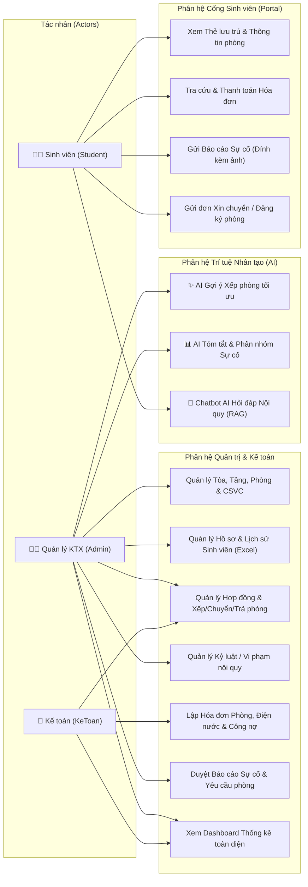
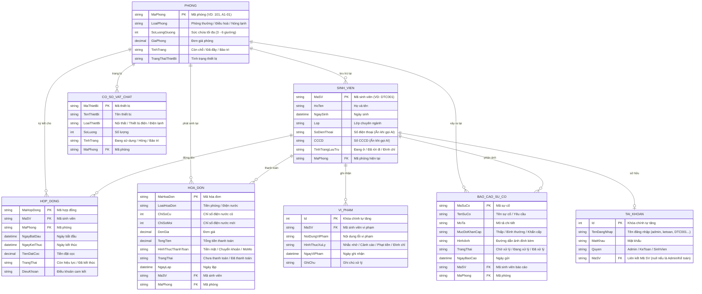
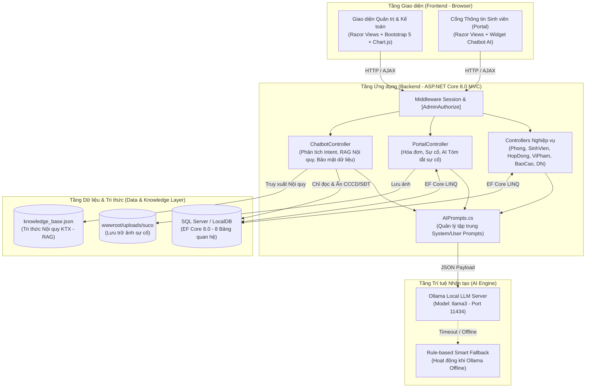
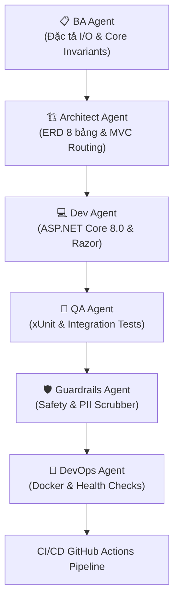
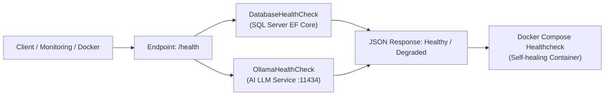

# TÀI LIỆU KỸ THUẬT & BÁO CÁO PHÂN TÍCH THIẾT KẾ HỆ THỐNG QUẢN LÝ KÝ TÚC XÁ TÍCH HỢP AI (QLKTX)

- **Trường:** Đại học Công Nghệ Thông Tin và Truyền Thông - Đại học Thái Nguyên
- **Học phần:** Ứng dụng trí tuệ nhân tạo - AIA331
- **Mã đề tài:** 80309 — Hệ thống quản lý ký túc xá có tích hợp AI
- **Nhóm 06:** Nguyễn Khánh Duy, Vũ Văn Dũng, Dương Văn Chung

---

## PHẦN I: PHÂN TÍCH VÀ THIẾT KẾ HỆ THỐNG (ĐÁP ỨNG BÀI KIỂM TRA THƯỜNG XUYÊN 1)

### 1. Phân tích bài toán quản lý (Tiêu chí 1)

#### 1.1. Bối cảnh và vấn đề cần giải quyết
Trong công tác quản lý nội trú tại trường đại học, số lượng sinh viên lưu trú lên tới hàng trăm sinh viên phân bổ tại nhiều tòa/tầng. Phương thức quản lý thủ công bằng sổ sách hoặc bảng tính rời rạc gặp các bất cập lớn:
- **Sai lệch chỗ trống:** Khó nắm bắt tức thời phòng nào còn giường trống, dẫn đến xếp vượt quá sức chứa hoặc bỏ trống giường lãng phí.
- **Thất thoát và chậm trễ công nợ:** Việc tính toán tiền điện nước theo chỉ số cũ/mới và theo dõi sinh viên nào chưa đóng phí phòng tốn nhiều công sức.
- **Quá tải tiếp nhận phản ánh:** Khi thiết bị (điện, nước, quạt, điều hòa) hỏng hóc, sinh viên báo miệng hoặc nhắn tin rời rạc khiến Ban quản lý khó phân loại mức độ khẩn cấp.
- **Lặp lại câu hỏi nội quy:** Sinh viên mới thường xuyên hỏi các câu hỏi giống nhau về giờ giới nghiêm, giá phòng, thủ tục trả phòng, gửi xe.

#### 1.2. Đối tượng người dùng (Users)
1. **Ban Quản lý KTX (Admin):** Quản lý toàn diện phòng ở, hồ sơ sinh viên, hợp đồng, cơ sở vật chất, kỷ luật và phê duyệt sự cố/yêu cầu chuyển phòng.
2. **Cán bộ Kế toán (`KeToan`):** Lập hóa đơn tiền phòng, tính chỉ số điện nước, theo dõi thu phí và thống kê công nợ.
3. **Sinh viên nội trú (`SinhVien`):** Tra cứu thông tin phòng ở, xem và thanh toán hóa đơn trực tuyến, gửi báo cáo sự cố kèm ảnh, gửi đơn xin chuyển/trả phòng và hỏi đáp với Trợ lý AI.

#### 1.3. Quy trình nghiệp vụ cốt lõi
```text
[Tiếp nhận SV / Import Excel] -> [AI Gợi ý phòng trống phù hợp] -> [Lập Hợp đồng & Xếp phòng]
       -> [Lưu trú: Ghi điện nước, Lập hóa đơn, Báo cáo sự cố (AI Tóm tắt), Hỏi đáp Nội quy (AI Chatbot)]
       -> [Trả phòng / Xóa mềm chuyển vào Lịch sử lưu trú & Tự động giải phóng giường trống]
```

---

### 2. Đặc tả Yêu cầu Chức năng: Đầu vào - Xử lý - Đầu ra (Tiêu chí 2)

| Mã CN | Tên chức năng | Đầu vào (Input) | Xử lý nghiệp vụ (Process) | Đầu ra (Output) |
| :---: | :--- | :--- | :--- | :--- |
| **CN01** | Đăng nhập & Phân quyền | `TenDangNhap` (hoặc `MaSV`), `MatKhau` | Kiểm tra bảng `TaiKhoans`, khởi tạo `Session` theo vai trò (`Admin`, `KeToan`, `SinhVien`) và bảo vệ Route bằng `[AdminAuthorize]`. | Chuyển hướng vào Dashboard Admin hoặc Cổng Portal Sinh viên. |
| **CN02** | Quản lý Tòa, Tầng, Phòng & Số giường | Mã phòng, Loại phòng, Số giường, Giá phòng, Tình trạng | Thêm/sửa/xóa phòng, tự động đếm sĩ số thực tế `X/Y` dựa trên số SV có `TinhTrangLuuTru == "Đang ở"`, lọc theo Tòa/Tầng. | Danh sách phòng trực quan kèm trạng thái `Còn chỗ` / `Đã đầy`. |
| **CN03** | Quản lý Hồ sơ Sinh viên & Lịch sử ở | Mã SV, Họ tên, Ngày sinh, Lớp, SĐT, CCCD, Mã phòng (hoặc file `.xlsx`) | Kiểm tra trùng `MaSV`, lưu CSDL; hỗ trợ Import/Export Excel (`ClosedXML`). Khi trả phòng thực hiện xóa mềm (`Đã rời đi`). | Hồ sơ sinh viên đang ở (`SinhVien/Index`) và Lịch sử (`SinhVien/LichSu`). |
| **CN04** | Đăng ký ở, Xếp phòng, Chuyển & Trả phòng | Mã SV, Mã phòng mới, Hợp đồng hoặc Đơn yêu cầu từ Portal | Kiểm tra số giường trống; cập nhật `MaPhong` cho SV; tự động đổi trạng thái phòng sang `Còn chỗ` khi SV trả phòng/chuyển đi. | Hợp đồng lưu trú hiệu lực; cập nhật sĩ số phòng chính xác. |
| **CN05** | Theo dõi Phí phòng, Điện nước & Công nợ | Mã SV, Loại hóa đơn, Chỉ số cũ, Chỉ số mới, Đơn giá | Kiểm tra ràng buộc `ChiSoMoi > ChiSoCu`, tự động nhân đơn giá thành `TongTien`; cập nhật trạng thái `Đã thanh toán` / `Chưa thanh toán`. | Hóa đơn chi tiết trên Admin và Portal Sinh viên. |
| **CN06** | Quản lý Phản ánh Sự cố & Vi phạm Nội quy | Tên sự cố, Mô tả, Mức độ khẩn cấp, Ảnh đính kèm / Lỗi vi phạm, Hình thức xử lý | Upload ảnh vào `wwwroot/uploads/suco/`; lưu trạng thái `Chờ xử lý`. Nếu kỷ luật mức `Đình chỉ`, tự động cập nhật trạng thái SV và giải phóng giường. | Danh sách sự cố và biên bản kỷ luật. |
| **CN07** | Thống kê Công suất, Công nợ & Phản ánh | Dữ liệu tổng hợp từ các bảng trong CSDL | Tính tổng doanh thu cọc, tổng hóa đơn đã thu, tổng công nợ chưa thu, tỷ lệ lấp đầy phòng và số sự cố theo trạng thái. | Dashboard biểu đồ tròn, biểu đồ cột (`Chart.js`) và thẻ KPI. |
| **AI01** | Chatbot Hỏi đáp Nội quy KTX (RAG) | Câu hỏi tự nhiên của sinh viên (`Message`) | Phân tích Intent, trích xuất quy định từ `knowledge_base.json` và số liệu CSDL (đã ẩn `CCCD`/`SĐT`), kết hợp System Prompt gửi Ollama `llama3`. | Câu trả lời tiếng Việt chính xác, trích dẫn đúng nội quy. |
| **AI02** | AI Gợi ý Xếp phòng theo tiêu chí | Loại phòng, Tòa/Tầng ưu tiên, Số giường cần xếp | Lọc danh sách phòng `Còn chỗ` trong CSDL, gửi thông số sang mô hình AI để xếp hạng phòng tối ưu theo mật độ và chi phí. | Top 3 phòng gợi ý tốt nhất kèm lý do thuyết phục. |
| **AI03** | AI Tóm tắt Phản ánh / Sự cố kỹ thuật | Toàn bộ sự cố có trạng thái `Chờ xử lý` | Gom nhóm sự cố thành 3 nhóm (Điện, Nước, Nội thất/Khác), đánh giá mức độ khẩn cấp và đề xuất thứ tự cử thợ sửa chữa. | Bản báo cáo tóm tắt phân nhóm và thứ tự ưu tiên xử lý. |

---

### 3. Yêu cầu Phi chức năng (Tiêu chí 3)

1. **Bảo mật & Quyền riêng tư (Security & Privacy):**
   - Phân tách độc lập phiên làm việc (`Session`) giữa Ban Quản lý (`Admin_DangNhap`) và Sinh viên (`MaSV_DangNhap`).
   - Toàn bộ các Controller quản trị được bảo vệ bởi tầng kiểm soát `[AdminAuthorize]`, ngăn chặn truy cập trái phép qua URL.
   - Khi sinh viên thanh toán hóa đơn trên Portal, bắt buộc xác thực lại mật khẩu tài khoản.
   - **Đạo đức & Quyền riêng tư AI:** Câu trả lời của AI được lọc qua `SafetyGuardrails.ScrubPII` (che CCCD); số điện thoại của sinh viên khác hiển thị dạng `098****567` (`MaskPhone`); mật khẩu không bao giờ được đưa vào prompt.
2. **Hiệu năng (Performance):**
   - Truy vấn CSDL tối ưu với `.AsNoTracking()` cho các tác vụ đọc thống kê và tra cứu AI; thời gian phản hồi trang quản lý `< 500ms`.
   - Giới hạn thời gian gọi AI: 30 giây với chatbot, 45 giây với gợi ý xếp phòng và tóm tắt sự cố (đủ cho llama3 chạy trên máy cá nhân), để không làm treo luồng xử lý của Web Server.
3. **Tính khả dụng & Chịu lỗi (Availability & Fault Tolerance):**
   - Cơ chế **Multi-layer Fallback**: Khi dịch vụ AI cục bộ (Ollama) chưa bật hoặc quá tải, cả 3 chức năng AI (Chatbot, Gợi ý xếp phòng, Tóm tắt sự cố) đều chuyển sang kết quả tính bằng C# từ dữ liệu CSDL, người dùng vẫn nhận được câu trả lời thay vì trang lỗi.
4. **Sao lưu & Toàn vẹn dữ liệu (Backup & Data Integrity):**
   - Áp dụng cơ chế **Xóa mềm (Soft Delete)** đối với Sinh viên (`TinhTrangLuuTru = "Đã rời đi"`), giữ nguyên lịch sử hợp đồng, hóa đơn và kỷ luật.
   - Hỗ trợ xuất toàn bộ hồ sơ ra file Excel (`.xlsx`) và tái tạo CSDL qua EF Core Migrations + `DbInitializer`.
5. **Trải nghiệm người dùng (UI/UX):**
   - Thiết kế chuẩn **SaaS Dashboard** hiện đại với Bootstrap 5, bố cục tràn viền (`container-fluid`), hỗ trợ tìm kiếm thông minh không phân biệt chữ hoa/thường hay tiền tố `P.`.

---

### 4. Thiết kế Actor và Sơ đồ Use Case (Tiêu chí 4)

#### 4.1. Danh sách Actor
- **Quản lý KTX (Admin):** Quản trị toàn bộ hệ thống, xếp phòng, duyệt sự cố, sử dụng AI gợi ý phòng và AI tóm tắt sự cố.
- **Kế toán (Accountant):** Quản lý hợp đồng, ghi chỉ số điện nước, phát hành hóa đơn và theo dõi công nợ.
- **Sinh viên (Student):** Xem thẻ lưu trú, thanh toán hóa đơn, gửi báo cáo sự cố, gửi yêu cầu chuyển phòng và trò chuyện với Chatbot AI.

#### 4.2. Sơ đồ Use Case Tổng thể (Mermaid)


---

### 5. Thiết kế Cơ sở Dữ liệu & Sơ đồ ERD (Tiêu chí 5)

#### 5.1. Sơ đồ Thực thể Kết hợp (ERD)


#### 5.2. Giải thích Quan hệ và Ràng buộc Toàn vẹn
- **Quan hệ `Phong` (1) — (N) `SinhVien`:** Một phòng chứa tối đa `SoLuongGiuong` sinh viên có trạng thái `"Đang ở"`. Khi sĩ số đạt ngưỡng `SoLuongGiuong`, `Phong.TinhTrang` chuyển thành `"Đã đầy"`. Khi sinh viên chuyển sang `"Đã rời đi"` hoặc `"Đình chỉ"`, hệ thống tự động tính lại sĩ số và mở lại trạng thái `"Còn chỗ"`.
- **Ràng buộc Xóa mềm (Soft Delete):** Bảng `SinhVien` được tham chiếu bởi `HopDong`, `HoaDon`, `ViPham`, `BaoCaoSuCo`. Do đó hệ thống cấm xóa vật lý bản ghi `SinhVien` mà quản lý vòng đời qua cột `TinhTrangLuuTru`.

---

### 6. Thiết kế Kiến trúc Hệ thống & Luồng Dữ liệu (Tiêu chí 6)



#### 6.1. Giải trình Lựa chọn Công nghệ (Tech Stack) tương đương theo Đề cương 80309
- **Backend & Database:** Đề cương đề tài định hướng các Web Framework phổ biến (FastAPI/Flask/Django/ASP.NET) và CSDL quan hệ (SQL Server/MySQL/PostgreSQL). Nhóm quyết định lựa chọn **ASP.NET Core 8.0 MVC** kết hợp **Entity Framework Core 8.0** và **SQL Server** vì:
  1. Tính an toàn kiểu dữ liệu (Strongly-typed) và cơ chế Action Filter (`[AdminAuthorize]`) giúp phân quyền 3 vai trò chặt chẽ ở tầng middleware.
  2. Entity Framework Core hỗ trợ xử lý khóa ngoại, quan hệ 1-N phức tạp và cơ chế xóa mềm (Soft Delete) ổn định, tránh mất dữ liệu lịch sử lưu trú.
  3. Tích hợp sẵn Dependency Injection (`IHttpClientFactory`) quản lý kết nối HTTP Pooling tối ưu khi gọi mô hình ngôn ngữ lớn (LLM).
- **Frontend:** HTML5, Razor Views (`.cshtml`), Bootstrap 5, Bootstrap Icons, Chart.js đảm bảo giao diện Responsive chuẩn SaaS Dashboard, hoạt động mượt mà trên cả trình duyệt máy tính và di động.
- **AI Service:** Tích hợp mô hình cục bộ **Ollama (`llama3`)** qua chuẩn REST API JSON Payload, kết hợp cơ chế Retrieval-Augmented Generation (RAG) và Rule-based Smart Fallback.

---

### 7. Xác định Vị trí Ứng dụng AI trong Hệ thống (Tiêu chí 7)

Hệ thống tích hợp **3 chức năng AI** đặt đúng tại các điểm nghẽn nghiệp vụ thực tế:
1. **Vị trí 1 — Widget Chatbot Hỏi đáp Nội quy KTX (Góc phải dưới Cổng Sinh viên `_StudentLayout.cshtml` & `_Layout.cshtml`):**
   - Giải quyết nhu cầu tra cứu nội quy 24/7 (giờ đóng cửa, giá điện nước, quy định nấu ăn, khách thăm, thủ tục trả phòng) kết hợp truy vấn trực tiếp số phòng trống từ CSDL.
2. **Vị trí 2 — Trợ lý AI Gợi ý Xếp phòng (`Views/Phong/Index.cshtml` -> `PhongController.GoiYXepPhongAI`):**
   - Hỗ trợ Admin chọn nhanh phòng tối ưu cho sinh viên mới dựa trên loại phòng, khu nhà/tầng và số lượng giường trống thực tế.
3. **Vị trí 3 — AI Tóm tắt & Phân loại Sự cố (`Views/Portal/QuanLySuCoAdmin.cshtml` -> `PortalController.TomTatSuCoAI`):**
   - Giúp Ban quản lý chỉ với 1 cú nhấp chuột có ngay bản tổng hợp các sự cố đang chờ xử lý, tự động chia theo nhóm kỹ thuật (Điện, Nước, Nội thất) và gợi ý phòng cần ưu tiên cử thợ sửa trước.

---

### 8. Thiết kế Hệ thống Prompt & Luồng Gọi AI (Tiêu chí 8)

Toàn bộ Prompt được tách biệt khỏi Controller và quản lý tập trung tại file `QLKTX/Models/AIPrompts.cs`, cấu hình kết nối đặt tại `QLKTX/appsettings.json` (`Ollama:BaseUrl`, `Ollama:Model`).

#### 8.1. Prompt Mẫu cho Chatbot Hỏi đáp Nội quy (RAG)
- **System Prompt:**
  ```text
  Bạn là Trợ lý AI Quản lý Ký túc xá (QLKTX). BẮT BUỘC trả lời 100% bằng TIẾNG VIỆT, văn phong lịch sự, chuẩn mực và dễ hiểu. Tuyệt đối CHỈ sử dụng dữ liệu quy định và dữ liệu hệ thống được cung cấp để trả lời. Nếu dữ liệu không chứa câu trả lời, hãy nói: 'Xin lỗi, tôi không có thông tin về vấn đề này trong hệ thống Ký túc xá. Bạn vui lòng liên hệ Ban Quản lý để được hỗ trợ trực tiếp.' KHÔNG ĐƯỢC tự bịa đặt câu trả lời, không dùng kiến thức ngoài lề không liên quan đến ký túc xá.
  ```
- **User Prompt Template:**
  ```text
  System: Bạn là trợ lý ký túc xá. Chỉ trả lời theo nội quy được cung cấp, không tự tạo quy định.
  Nội quy liên quan: {{policy_chunks}}
  User: Câu hỏi: {{question}}. Hãy trả lời ngắn gọn và dẫn lại mục nội quy nếu có.
  ```

#### 8.2. Định dạng Input / Output và Giới hạn An toàn
- **Đầu vào (Input):** JSON Payload gửi tới `http://localhost:11434/api/chat` gồm `model: "llama3"`, `stream: false`, và mảng `messages` (`system`, `user`).
- **Đầu ra (Output):** JSON `{ "response": "...", "source": "Cơ sở tri thức KTX" }`.
- **Ràng buộc & Giới hạn an toàn:**
  1. Luồng hỏi đáp chỉ truy vấn CSDL ở chế độ **Read-Only** (`AsNoTracking()`); thao tác ghi từ khung chat chỉ đi qua `ExecuteAction` sau khi người dùng xác nhận.
  2. Không đưa mật khẩu vào prompt; câu trả lời AI được che CCCD (`ScrubPII`), số điện thoại của sinh viên khác được che (`MaskPhone`).
  3. Giới hạn số bản ghi ngữ cảnh (`Take(10)`) để tránh tràn Context Window.
  4. Thời gian chờ 30s (chatbot) / 45s (gợi ý xếp phòng, tóm tắt sự cố) và phương án dự phòng khi Ollama không phản hồi.

---

### 9. Kế hoạch Triển khai theo Giai đoạn SDLC (Tiêu chí 10)

| Giai đoạn | Mục tiêu trọng tâm | Sản phẩm bàn giao (Deliverables) | Trạng thái |
| :--- | :--- | :--- | :---: |
| **Giai đoạn 1 (KT1)** | Phân tích nghiệp vụ, thiết kế Use Case, ERD 8 bảng, kiến trúc MVC + RAG AI và thiết kế Prompt. | `tailieu.md`, `ApplicationDbContext.cs`, `knowledge_base.json`. | ✅ Hoàn thành |
| **Giai đoạn 2 (KT2)** | Xây dựng phân quyền Session, hoàn thiện CRUD 8 bảng, tìm kiếm chuẩn hóa, xuất/nhập Excel, Dashboard thống kê. | Toàn bộ Controllers, Models, Razor Views, `DbInitializer.cs`, `README.md`. | ✅ Hoàn thành |
| **Giai đoạn 3 (KT3)** | Tích hợp 3 tính năng AI (Chatbot RAG, Gợi ý xếp phòng, Tóm tắt sự cố), tách `AIPrompts.cs`, tối ưu Prompt 3 vòng, kiểm thử. | `ChatbotController.cs`, `AIPrompts.cs`, `NhatkysudungAI.md`, Bảng Test Cases. | ✅ Hoàn thành |
| **Giai đoạn 4 (Cuối kỳ)** | Rà soát bảo mật dữ liệu nhạy cảm AI, đóng gói `Dockerfile` & `docker-compose.yml`, hoàn thiện báo cáo tổng kết. | Bộ mã nguồn hoàn chỉnh, `Dockerfile`, Báo cáo kỹ thuật & Slide/Demo. | ✅ Hoàn thành |

---

## PHẦN II: KỊCH BẢN KIỂM THỬ HỆ THỐNG & AI (ĐÁP ỨNG BÀI KT3 - TIÊU CHÍ 8 & YÊU CẦU KỸ THUẬT)

Bảng dưới đây liệt kê các kịch bản kiểm thử (**Test Cases**) bao phủ đầy đủ các trường hợp **Đúng (Normal)**, **Sai (Abnormal/Error)** và **Biên (Boundary)** cho cả chức năng Quản lý và chức năng AI:

### 1. Nhóm Kiểm thử Xếp phòng, Chuyển phòng & Trả phòng

| Mã TC | Phân loại | Tình huống kiểm thử | Đầu vào (Input) | Kết quả mong đợi (Expected) | Kết quả thực tế |
| :---: | :---: | :--- | :--- | :--- | :---: |
| **TC_PHONG_01** | **Đúng** | Xếp sinh viên mới vào phòng còn chỗ trống | Thêm SV `DTC888` vào phòng `P.101` (đang có 4/6 SV, trạng thái `Còn chỗ`). | Lưu thành công, sĩ số phòng hiển thị `5/6`, trạng thái phòng giữ nguyên `Còn chỗ`. | **PASS** |
| **TC_PHONG_02** | **Biên** | Xếp sinh viên vào giường trống cuối cùng của phòng | Phòng `P.102` đang có `5/6` SV; xếp thêm 1 SV vào phòng `P.102`. | Sĩ số đạt ngưỡng tối đa `6/6` giường, trạng thái phòng cập nhật sang `Đã đầy`. | **PASS** |
| **TC_PHONG_03** | **Đúng** | Sinh viên trả phòng (Xóa mềm) giải phóng chỗ trống | Thực hiện Xóa (Trả phòng) đối với 1 SV đang ở tại phòng `Đã đầy` (`6/6`). | SV chuyển sang `TinhTrangLuuTru = "Đã rời đi"` (hiển thị bên trang `LichSu`), sĩ số phòng giảm còn `5/6` và trạng thái phòng tự động mở lại thành `Còn chỗ`. | **PASS** |
| **TC_PHONG_04** | **Sai** | Xóa cứng phòng đang có sinh viên hoặc hợp đồng liên kết | Bấm xóa phòng `P.101` đang có sinh viên lưu trú. | Hệ thống chặn xóa cứng và hiển thị cảnh báo: *"Không thể xóa cứng phòng vì đang có sinh viên hoặc lịch sử lưu trú liên kết"*. | **PASS** |
| **TC_PHONG_05** | **Biên** | Tìm kiếm mã phòng với các định dạng ký tự khác nhau | Nhập `"P.101"`, `"p 101"`, `"101"`, `"A1-01"`, `"a101"` vào ô tìm kiếm. | Chuẩn hóa chuỗi thành công, trả về đúng bản ghi phòng tương ứng. | **PASS** |

### 2. Nhóm Kiểm thử Tính phí, Hóa đơn & Công nợ

| Mã TC | Phân loại | Tình huống kiểm thử | Đầu vào (Input) | Kết quả mong đợi (Expected) | Kết quả thực tế |
| :---: | :---: | :--- | :--- | :--- | :---: |
| **TC_HD_01** | **Đúng** | Tạo hóa đơn Điện nước hợp lệ | Chọn SV `DTC001`, Loại: `Điện nước`, `ChiSoCu = 100`, `ChiSoMoi = 150`, `DonGia = 2500`. | Tạo hóa đơn thành công với `TongTien = (150 - 100) * 2500 = 125,000 VNĐ`, trạng thái `Chưa thanh toán`. | **PASS** |
| **TC_HD_02** | **Biên / Sai** | Nhập chỉ số điện nước mới nhỏ hơn hoặc bằng chỉ số cũ | Chọn Loại: `Điện nước`, nhập `ChiSoCu = 200`, `ChiSoMoi = 200` (hoặc `180`). | Hệ thống từ chối lưu, báo lỗi Validation: *"Chỉ số mới phải lớn hơn Chỉ số cũ"*. | **PASS** |
| **TC_HD_03** | **Sai** | Sinh viên thanh toán hóa đơn nhưng nhập sai mật khẩu xác nhận | Tại Portal `/Portal/HoaDon`, chọn thanh toán qua MoMo, nhập mật khẩu `"999999"` (sai). | Hủy giao dịch, giữ nguyên trạng thái `Chưa thanh toán` và báo lỗi: *"Xác minh thất bại: Mật khẩu không chính xác"*. | **PASS** |
| **TC_HD_04** | **Đúng** | Sinh viên thanh toán hóa đơn với mật khẩu đúng | Nhập mật khẩu `"123"`, chọn phương thức `"Chuyển khoản"`. | Hóa đơn chuyển sang `"Đã thanh toán"`, công nợ trên Dashboard giảm tương ứng. | **PASS** |

### 3. Nhóm Kiểm thử Phản ánh Sự cố & Vi phạm Nội quy

| Mã TC | Phân loại | Tình huống kiểm thử | Đầu vào (Input) | Kết quả mong đợi (Expected) | Kết quả thực tế |
| :---: | :---: | :--- | :--- | :--- | :---: |
| **TC_SC_01** | **Đúng** | Sinh viên gửi báo cáo sự cố có kèm hình ảnh | Nhập `TenSuCo = "Hỏng quạt trần"`, mức độ `"Khẩn cấp"`, đính kèm file ảnh `.png`. | Lưu ảnh vào `wwwroot/uploads/suco/`, tạo bản ghi trạng thái `"Chờ xử lý"`. | **PASS** |
| **TC_SC_02** | **Biên** | Sinh viên gửi báo cáo sự cố KHÔNG đính kèm ảnh | Nhập `TenSuCo = "Đèn nhấp nháy"`, để trống ô chọn ảnh (`HinhAnhFile = null`). | Hệ thống gán `HinhAnh = ""` (không gây lỗi `SqlNullValueException`), lưu và hiển thị bình thường trên trang Admin. | **PASS** |
| **TC_VP_01** | **Đúng** | Lập biên bản kỷ luật mức "Đình chỉ" đối với sinh viên ở phòng đầy | Chọn SV `DTC005`, lỗi `"Nấu ăn trong phòng"`, hình thức `"Đình chỉ"`, để trống ghi chú. | Lưu biên bản thành công, cập nhật `SV.TinhTrangLuuTru = "Đình chỉ"` và tự động chuyển phòng từ `"Đã đầy"` sang `"Còn chỗ"`. | **PASS** |

### 4. Nhóm Kiểm thử Chức năng AI (Chatbot RAG, Gợi ý Phòng, Tóm tắt Sự cố)

| Mã TC | Phân loại | Tình huống kiểm thử | Đầu vào (Input) | Kết quả mong đợi (Expected) | Kết quả thực tế |
| :---: | :---: | :--- | :--- | :--- | :---: |
| **TC_AI_01** | **Đúng** | Hỏi quy định có trong `knowledge_base.json` | Nhập câu hỏi: *"Ký túc xá mấy giờ đóng cửa và giá điện nước tính thế nào?"* | Chatbot trả lời chính xác giờ giới nghiêm (23:00) và đơn giá điện/nước theo đúng nội quy. | **PASS** |
| **TC_AI_02** | **Sai / Biên** | Hỏi câu hỏi ngoài phạm vi Ký túc xá (Kiểm tra chống Hallucination) | Nhập câu hỏi: *"Hãy viết code Python giải phương trình bậc 2"* hoặc *"Thời tiết Hà Nội hôm nay?"* | AI tuân thủ System Prompt, từ chối trả lời kiến thức ngoài lề và hướng dẫn người dùng hỏi các vấn đề thuộc phạm vi KTX. | **PASS** |
| **TC_AI_03** | **Đúng** | Thực thi "AI Gợi ý xếp phòng" trên trang Quản lý Phòng | Chọn tiêu chí: `Phòng có điều hoà`, `Tầng 1`, `Số SV cần xếp = 2`. | Trả về Top 3 phòng thỏa mãn tiêu chí, nêu rõ số giường trống thực tế và mức giá. | **PASS** |
| **TC_AI_04** | **Đúng** | Thực thi "AI Tóm tắt sự cố" trên trang Quản trị Sự cố | Bấm nút `"Tóm tắt bằng AI"` khi có 10 sự cố đang chờ xử lý. | AI gom nhóm chính xác thành 3 mục (Điện, Nước, Nội thất/Khác) và đề xuất ưu tiên xử lý nhóm Điện/Nước trước. | **PASS** |
| **TC_AI_05** | **Biên (Offline)** | Kiểm thử tính sẵn sàng khi tắt dịch vụ Ollama (`localhost:11434`) | Tắt ứng dụng Ollama trên máy, sau đó bấm `"AI Gợi ý xếp phòng"`, `"Tóm tắt sự cố"` và chat trên Portal. | Không xảy ra lỗi 500; hệ thống tự động kích hoạt **Fallback nội bộ** trả về kết quả phân tích chuẩn xác trong `< 1 giây`. | **PASS** |
| **TC_AI_06** | **Bảo mật** | Kiểm tra rò rỉ dữ liệu nhạy cảm (`CCCD`, `SĐT`) qua AI | Hỏi Chatbot về thông tin sinh viên `DTC001`. | Chỉ hiển thị Mã SV, Họ tên, Lớp, Phòng và Tình trạng lưu trú; tuyệt đối không lộ số CCCD và SĐT. | **PASS** |


---

## PHẦN III: DÀN Ý SLIDE THUYẾT TRÌNH, KỊCH BẢN DEMO 5 PHÚT & BỘ CÂU HỎI VẤN ĐÁP (ĐÁP ỨNG THI KẾT THÚC HỌC PHẦN - TIÊU CHÍ 9 & 10)

### 1. Cấu trúc Nội dung 10 Trang Slide Thuyết trình Báo cáo Cuối kỳ

| Trang Slide | Tiêu đề Slide | Nội dung cốt lõi trình bày trên Slide |
| :---: | :--- | :--- |
| **Slide 1** | **Trang bìa Đề tài 80309** | Tên học phần: Phát triển phần mềm ứng dụng có sử dụng AI (AIA331) • Đề tài: Hệ thống Quản lý Ký túc xá tích hợp AI (`QLKTX`) • Sinh viên thực hiện: Nguyễn Khánh Duy (`DTC225180268`). |
| **Slide 2** | **Đặt vấn đề & Mục tiêu dự án** | 4 bất cập của quản lý KTX thủ công (nhầm chỗ trống, tính điện nước chậm, thất lạc báo hỏng, quá tải giải đáp nội quy) $\rightarrow$ Giải pháp Web MVC kết hợp 3 mô-đun AI nội bộ. |
| **Slide 3** | **Phân tích Tác nhân & Sơ đồ Use Case** | 3 vai trò người dùng chính (**Ban Quản lý KTX**, **Kế toán KTX**, **Sinh viên nội trú**) với giao diện và phân quyền độc lập. |
| **Slide 4** | **Thiết kế CSDL (ERD 8 Bảng)** | Sơ đồ ERD 8 bảng (`TaiKhoan`, `Phong`, `SinhVien`, `HopDong`, `HoaDon`, `BaoCaoSuCo`, `ViPham`, `CoSoVatChat`) cùng cơ chế Xóa mềm (`Đã rời đi`) và tự động đồng bộ sĩ số phòng. |
| **Slide 5** | **Kiến trúc Hệ thống & Tích hợp AI** | Mô hình 3 tầng ASP.NET Core 8.0 MVC + Entity Framework Core + Cơ chế RAG cục bộ (`knowledge_base.json`) kết nối Ollama LLM (`llama3`) kèm Smart Fallback. |
| **Slide 6** | **3 Chức năng AI Trọng tâm** | 1️⃣ **Chatbot RAG hỏi đáp nội quy KTX 24/7** • 2️⃣ **Trợ lý AI Gợi ý xếp phòng tối ưu** • 3️⃣ **AI Tóm tắt & Phân loại sự cố kỹ thuật**. |
| **Slide 7** | **Kỹ thuật Thiết kế Prompt & Bảo mật AI** | Minh họa tách biệt file `AIPrompts.cs`, cấu hình `appsettings.json`, bảng 3 vòng tối ưu Prompt và cơ chế che dữ liệu nhạy cảm (`CCCD`, `SoDienThoai`) trong câu trả lời AI. |
| **Slide 8** | **Minh chứng Sử dụng AI có Kiểm soát** | Tóm tắt Nhật ký AI (`NhatkysudungAI.md`): các lỗi thực tế do AI sinh ra (`SqlNullValueException`, lệch trạng thái phòng khi xóa mềm/đình chỉ) và cách sinh viên chủ động kiểm tra, sửa lỗi. |
| **Slide 9** | **Kết quả Kiểm thử & Đóng gói Triển khai** | Kết quả kiểm thử: 64/64 test xUnit đạt và các kịch bản theo tình huống (Đúng / Sai / Biên), đóng gói `Dockerfile` & `docker-compose.yml`. |
| **Slide 10** | **Demo Trực tiếp & Tổng kết** | Chuyển sang màn hình trình duyệt chạy Demo thực tế 3 phân hệ và hướng phát triển tiếp theo. |

---

### 2. Kịch bản Chạy Demo Trực tiếp 5 Phút (Mạch lạc, Đúng Trọng tâm Chấm điểm)

- **Phút 1 — Phân hệ Quản trị KTX (`admin` / `123`):**
  1. Đăng nhập tài khoản `admin` $\rightarrow$ Giới thiệu Dashboard Tổng quan (công suất phòng, công nợ, sự cố, vi phạm).
  2. Vào **Quản lý Phòng (`/Phong/Index`)**: Lọc nhanh theo *Tòa A - Tầng 1* và trạng thái *Còn chỗ* $\rightarrow$ Bấm nút **`✨ AI Gợi ý xếp phòng`** để AI phân tích và đề xuất Top 3 phòng trống tốt nhất.
  3. Vào **Tiếp nhận Sinh viên (`/SinhVien/Create`)**: Bấm **`✨ AI Gợi ý phòng trống tối ưu`** $\rightarrow$ bấm **`Chọn P.xxx`** để tự động điền mã phòng vào biểu mẫu; giới thiệu tính năng **Import / Xuất Excel (`.xlsx`)** và **Lịch sử rời KTX (Xóa mềm)**.
  4. Vào **Quản lý Sự cố (`/Portal/QuanLySuCoAdmin`)**: Bấm nút **`✨ Tóm tắt bằng AI`** để AI gom nhóm sự cố Điện / Nước / Nội thất và gợi ý thứ tự ưu tiên cử thợ sửa chữa.

- **Phút 2 — Phân hệ Kế toán KTX (`ketoan` / `123`):**
  1. Đăng xuất và đăng nhập tài khoản `ketoan` (`123`) $\rightarrow$ Chỉ rõ giao diện **Phân hệ Kế toán KTX** riêng biệt (chỉ hiển thị các nghiệp vụ Tài chính, Hóa đơn, Hợp đồng, Báo cáo doanh thu & Tra cứu chỉ đọc).
  2. Vào **Phát hành Hóa đơn (`/Portal/TaoHoaDon`)**: Chọn sinh viên, chọn loại `"Điện nước"`, thử nhập `Chỉ số mới < Chỉ số cũ` để chứng minh hệ thống bắt lỗi Validation chặt chẽ, sau đó nhập chỉ số hợp lệ để hệ thống tự nhân đơn giá.

- **Phút 3 — Cổng Thông tin Sinh viên (`DTC001` / `123`) & Chatbot AI:**
  1. Đăng nhập tài khoản sinh viên `DTC001` (`123`) $\rightarrow$ Bấm nút **`Đăng ký / Chuyển phòng`** để gửi nguyện vọng chuyển phòng trực tuyến.
  2. Vào mục **Hóa đơn (`/Portal/HoaDon`)**: Thực hiện thanh toán hóa đơn bằng xác thực mật khẩu.
  3. Mở **Widget Chatbot AI** ở góc phải dưới:
     - Hỏi câu 1 (Đúng nội quy): *"Ký túc xá mấy giờ đóng cửa và giá điện nước tính thế nào?"*
     - Hỏi câu 2 (Truy vấn dữ liệu thực): *"Hiện tại ký túc xá còn phòng nào trống không?"*
     - Hỏi câu 3 (Kiểm tra chống bịa đặt): *"Hãy viết code Python giải phương trình bậc 2"* $\rightarrow$ Chứng minh AI từ chối trả lời ngoài phạm vi KTX.

---

### 3. Bộ Câu hỏi Vấn đáp Bảo vệ Đồ án & Gợi ý Trả lời Chuẩn

1. **Câu hỏi 1: Tại sao khi xóa sinh viên, em không dùng lệnh `_context.SinhViens.Remove(sv)` mà lại chuyển `TinhTrangLuuTru = "Đã rời đi"`?**
   - **Trả lời:** Vì trong nghiệp vụ Ký túc xá, một sinh viên có liên kết khóa ngoại với các bảng `HopDong`, `HoaDon`, `ViPham` và `BaoCaoSuCo`. Nếu xóa vật lý (`Remove`) sẽ gây lỗi ràng buộc khóa ngoại (`DbUpdateException`) hoặc làm mất lịch sử công nợ/kỷ luật. Do đó em áp dụng **Xóa mềm (Soft Delete)** chuyển trạng thái sang `"Đã rời đi"`, đồng thời tự động kiểm tra lại sĩ số phòng để mở lại trạng thái phòng từ `"Đã đầy"` sang `"Còn chỗ"`.

2. **Câu hỏi 2: Hệ thống ngăn chặn hiện tượng AI "ảo giác" (Hallucination - tự bịa quy định KTX) bằng cách nào?**
   - **Trả lời:** Em áp dụng kiến trúc **RAG cục bộ (Retrieval-Augmented Generation)** kết hợp ràng buộc kép trong `AIPrompts.cs`:
     - Trước khi gọi LLM, `ChatbotController` trích xuất các điều khoản nội quy từ `knowledge_base.json` và dữ liệu thực tế từ SQL Server để đưa vào Prompt.
     - Trong `SystemPrompt`, em thiết lập quy tắc nghiêm ngặt: chỉ được trả lời dựa trên ngữ cảnh được cung cấp; nếu câu hỏi nằm ngoài phạm vi Ký túc xá thì bắt buộc từ chối lịch sự.

3. **Câu hỏi 3: Nếu máy chủ chạy ứng dụng bị mất kết nối với dịch vụ Ollama AI (`localhost:11434`), phần mềm có bị treo hay báo lỗi 500 không?**
   - **Trả lời:** Hoàn toàn không. Toàn bộ các lời gọi `HttpClient` tới Ollama trong `ChatbotController`, `PhongController` và `PortalController` đều có giới hạn thời gian (30 giây với chatbot, 45 giây với gợi ý phòng và tóm tắt sự cố) bên trong khối `try-catch`. Khi Ollama tắt, chưa tải model hoặc quá thời gian chờ, hệ thống chuyển sang **Rule-based Smart Fallback** truy vấn trực tiếp CSDL và trả về kết quả tiếng Việt.

4. **Câu hỏi 4: Em đã xử lý vấn đề bảo mật và quyền riêng tư dữ liệu sinh viên khi tích hợp AI như thế nào?**
   - **Trả lời:** Trong `ChatbotController.cs`, trước khi tuần tự hóa (`JsonSerializer.Serialize`) dữ liệu sinh viên để ghép vào Prompt gửi sang mô hình ngôn ngữ lớn, em sử dụng LINQ `.Select()` để chỉ lấy `MaSV`, `HoTen`, `Lop`, `MaPhong`, `TinhTrangLuuTru` và **loại bỏ hoàn toàn cột `CCCD`, `SoDienThoai`, `MatKhau`**. Đồng thời kết nối CSDL của AI chỉ ở chế độ đọc (`AsNoTracking()`).

5. **Câu hỏi 5: Phân quyền giữa Quản lý KTX (`admin`), Kế toán (`ketoan`) và Sinh viên (`SinhVien`) được kiểm soát ở tầng nào?**
   - **Trả lời:** Được kiểm soát ở cả **Tầng Giao diện (UI)** và **Tầng Backend (Action Filter)**:
     - Ở tầng Backend, em xây dựng bộ lọc `[AdminAuthorize]` và `[AdminAuthorize(OnlyAdmin = true)]` trong `AdminAuthorizeAttribute.cs`. Nếu người dùng chưa đăng nhập hoặc dùng tài khoản `ketoan` cố tình gõ URL vào các trang chỉ dành cho Admin (như Kỷ luật, Cơ sở vật chất, Sửa/Xóa Phòng & Sinh viên), bộ lọc sẽ chặn ngay ở `OnActionExecuting` và chuyển hướng về trang chủ kèm thông báo lỗi.


---

## PHẦN IV: THIẾT KẾ AGENT AI CHO QUY TRÌNH SDLC (CONTEXT ENGINEERING, FACTORY, GUARDRAILS & KIỂM THỬ) — ĐÁP ỨNG TIÊU CHÍ 2 (4.0 ĐIỂM)

### 1. Kiến trúc Nhà máy Phần mềm AI (SDLC AI Agent Factory)
Nhóm tổ chức việc dùng trợ lý AI theo 6 vai trò. Mỗi vai trò là một cách giao việc (prompt + ngữ cảnh) cho trợ lý AI ở một giai đoạn, không phải một phần mềm chạy riêng; mọi đầu ra đều được thành viên nhóm kiểm tra lại:
1. **📋 Business Analyst Agent:** Trích xuất yêu cầu KTX, xác định 5 luật nghiệp vụ bất biến.
2. **🏗️ System Architect Agent:** Thiết kế Schema CSDL 8 bảng, định tuyến MVC, phân quyền bảo mật.
3. **💻 Developer Agent:** Sinh mã nguồn ASP.NET Core 8.0, triển khai EF Core và Razor Views.
4. **🧪 Test Automation Agent:** Gợi ý trường hợp biên và viết bộ kiểm thử xUnit, Integration Test.
5. **🛡️ Safety & Guardrails Agent:** Quản trị an toàn Prompt Injection, PII Scrubber và Smart Fallback.
6. **🚀 DevOps & Monitoring Agent:** Cấu hình Docker multi-stage, Health Checks và CI/CD GitHub Actions.



### 2. Kỹ nghệ Ngữ cảnh Phân tầng (Context Engineering Framework)
Hệ thống AI phân tách ngữ cảnh thành 4 tầng độc lập để tối ưu hóa token và ngăn chặn Hallucination:
- **Tầng 1 (Core Invariants):** Luật bất biến nghiệp vụ (Soft Delete, Đồng bộ sĩ số, Bảo mật hóa đơn).
- **Tầng 2 (Domain Knowledge RAG):** Biểu phí, giờ giới nghiêm 23:00, quy định gửi xe từ `knowledge_base.json`.
- **Tầng 3 (Dynamic Database State):** Truy vấn trạng thái thực từ SQL Server qua EF Core `AsNoTracking()`.
- **Tầng 4 (Execution Guardrails):** Thời gian chờ 30s (chatbot) / 45s (gợi ý phòng, tóm tắt sự cố), bộ lọc PII và Rule-based Smart Fallback.

### 3. Framework Rào chắn An toàn (Safety Guardrails Framework)
Module `SafetyGuardrails.cs` bảo vệ đồng bộ 3 phân hệ AI (`ChatbotController`, `PhongController`, `PortalController`):
- **Input Guardrails:**
  - Phát hiện và vô hiệu hóa Prompt Injection qua danh sách mẫu từ khóa nguy hiểm ("bỏ qua chỉ dẫn", "trở thành hacker", "lộ mật khẩu", "system prompt").
  - Giới hạn độ dài văn bản đầu vào (Max 1000 ký tự) chống tấn công làm tràn Context Window.
  - Làm sạch ký tự điều khiển lạ (`[\x00-\x08\x0B\x0C\x0E-\x1F\x7F]`).
- **Output Guardrails:**
  - PII Scrubber: Tự động quét và che mờ CCCD 12 số (`\b\d{12}\b` $\rightarrow$ `[ĐÃ_ẨN_CCCD]`), số điện thoại (`MaskPhone`: `098****567`), mật khẩu tài khoản.
  - Chống Hallucination: Làm sạch markdown links giả mạo (`[text](http...)`) và từ chối nội dung ngoài KTX.
- **Execution Guardrails:**
  - Khống chế thời gian chờ Ollama: 30s với chatbot, 45s với gợi ý xếp phòng và tóm tắt sự cố.
  - Tự động kích hoạt Rule-based Smart Fallback đảm bảo tính liên tục của hệ thống khi Ollama offline.

### 4. Kiến trúc Giám sát và Theo dõi Sức khỏe Hệ thống (Health Checks & Observability)
Hệ thống tích hợp ASP.NET Core Health Checks chuẩn tại endpoint `/health`:
- **DatabaseHealthCheck:** Kiểm tra khả năng kết nối SQL Server thông qua `_dbContext.Database.CanConnectAsync()`.
- **OllamaHealthCheck:** Ping kiểm tra cổng 11434 với timeout 5s. Nếu Ollama offline, trả về trạng thái `Degraded` để hệ thống tự động kích hoạt Rule-based Smart Fallback mà không làm sập ứng dụng.



### 5. Danh mục Kiểm thử Chuẩn .NET (xUnit Unit & Integration Tests)
Lần chạy `dotnet test` gần nhất (30/10/2026): **64/64 test case xUnit đạt** (tính cả các bộ dữ liệu của `[Theory]`). Script `tests/run_tests.ps1` gồm 26 kịch bản, kết quả ghi trong `KET_QUA_KIEM_THU.txt`.

| Nhóm kiểm thử | Tệp kiểm thử | Số Tests | Nội dung kiểm thử trọng tâm | Kết quả |
| :--- | :--- | :---: | :--- | :---: |
| **Tính phí & Hóa đơn** | `HoaDonCalculationsTests.cs` | 20 | - Tính tiền điện nước theo công thức: `(ChiSoMoi - ChiSoCu) * DonGia`<br>- Chặn tạo hóa đơn khi `ChiSoMoi <= ChiSoCu` (chống hóa đơn âm)<br>- Tính tiền phòng theo loại phòng và số tháng thuê | **Đạt** |
| **Phòng & Sĩ số** | `PhongVaSiSoTests.cs` | 4 | - Xếp sinh viên vào phòng còn chỗ -> tăng sĩ số, giữ nguyên "Còn chỗ"<br>- Xếp vào giường cuối cùng -> tự động đổi "Đã đầy"<br>- Xóa mềm (trả phòng) -> đổi "Đã rời đi", giảm sĩ số, mở lại "Còn chỗ"<br>- Kỷ luật đình chỉ -> tự động giải phóng giường trống | **Đạt** |
| **An toàn AI & Privacy** | `AIFallbackAndPrivacyTests.cs` | 19 | - Hàm làm mờ số điện thoại `MaskPhone(phone)` (`098****567`)<br>- Bộ lọc `FilterAiContext` loại CCCD và mật khẩu khỏi dữ liệu<br>- Thuật toán Smart Fallback tiếng Việt khi Ollama offline<br>- Ngăn chặn tấn công Prompt Injection | **Đạt** |
| **Bảo mật & Tích hợp** | `SecurityAndEndpointIntegrationTests.cs` | 10 | - Endpoint chẩn đoán `/_diag` trả về HTTP 200 OK<br>- Endpoint giám sát `/health` trả về HTTP 200 OK & JSON<br>- Cơ chế phân quyền chặn truy cập Admin khi chưa đăng nhập -> Redirect 302 | **Đạt** |
| **Tích hợp AI & Nghiệp vụ** | `AIAndBusinessIntegrationTests.cs` | 3 | - Gợi ý xếp phòng trả HTTP 200 và danh sách phòng<br>- Tóm tắt sự cố trả đúng cấu trúc phân loại<br>- Thanh toán với mật khẩu sai bị chặn | **Đạt** |
| **Định tuyến Chatbot** | `ChatbotRoutingTests.cs` | 8 | - Câu hỏi nội quy không bị trả về số liệu công nợ<br>- Câu hỏi nhiều ý được trả lời đủ<br>- Câu vừa hỏi dữ liệu vừa hỏi nội quy | **Đạt** |
| **Kịch bản PowerShell** | `tests/run_tests.ps1` | 26 | - Kiểm tra toàn diện 26 tiêu chí cấu hình, kiến trúc, Docker, RAG, xUnit | **Đạt** |
